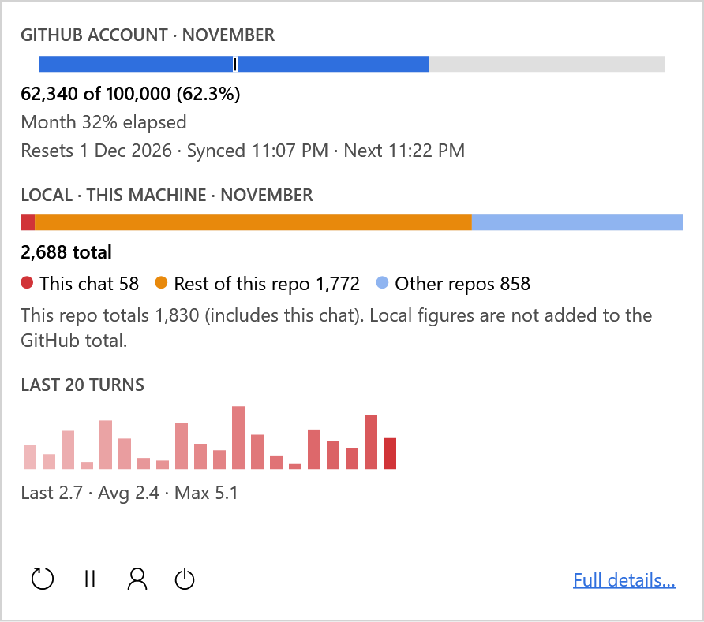
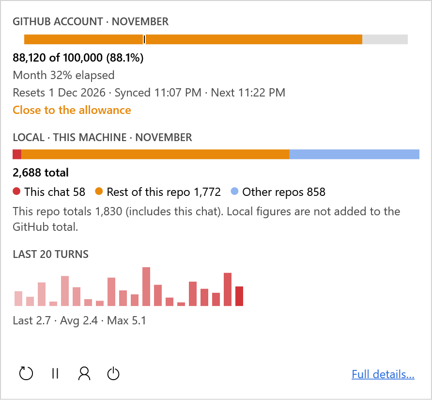
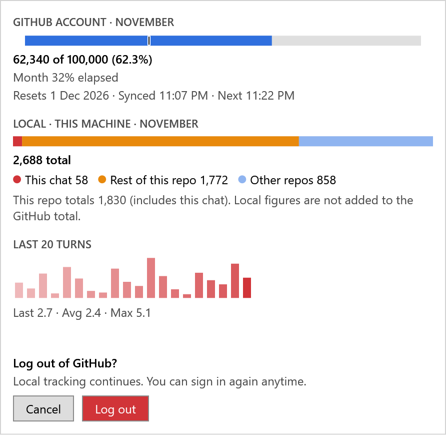
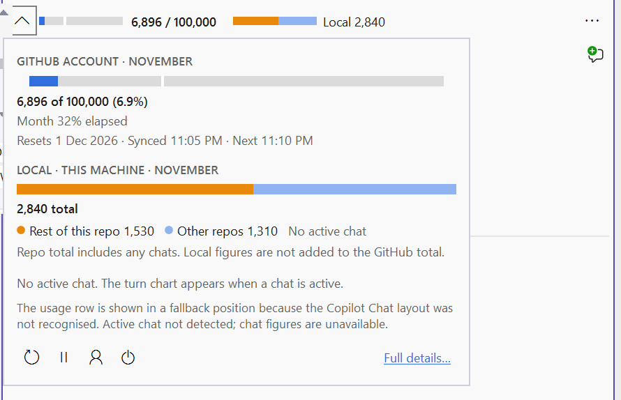
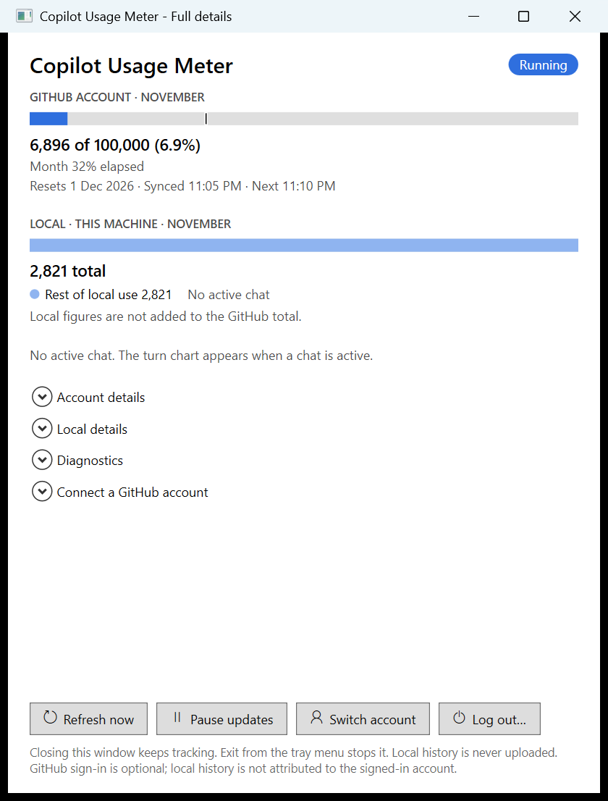

# CopilotUsageMeter

Windows tray host and experimental compact Visual Studio usage expander. GitHub-reported account allowance/consumption is separate from locally recorded repository, token and current-chat analytics. Local history is never uploaded.

## Current state - Phase 4 complete; compact UI reworked after Phase 4

The normal tray now hosts real local tracking, optional GitHub account tracking and the same-user pipe server. The Debug solution/VSIX build and **599 automated tests** pass. A later increment (user-authorised, not Phase 5) adds a progress bar to the Visual Studio row/popup and the tray Full details window while the tray is reading account or local data (shown only after a read has run for 500 ms, so quick refreshes do not flash it), and redraws the tray icon with a thin light track and a thick cyan arc (orange from 80%, red at 100%) so the usage level is readable at 16 px. A usage-alerts increment (user-authorised, not Phase 5; stage 1 of 3) adds opt-in alerts, off by default, in an "Alerts..." window (Full details toolbar or tray menu "Usage alerts..."): levels are whole percentages of the GitHub-reported monthly allowance (80 and 100 by default; add your own such as 50, up to 10, 1-200%), each with its own channel (Windows notification, a small message window, or off). A level alerts once per UTC month, never for levels you add at or below your current usage, and only from fresh GitHub account data (never local credits); settings and the fired levels are kept in `%LOCALAPPDATA%\CopilotUsageMeter\alerts.json` and `alert-state.json`, and notification text is fixed wording plus numbers. Stage 2 (user-authorised) adds tray problem notifications, on by default with a "Notify me about problems" switch in the same window: a Windows notification when you are not signed in at launch, the saved sign-in expires, GitHub reports usage as unavailable for the account, GitHub usage cannot be read 3 times in a row, a network outage lasts at least 30 minutes (shorter drops are deliberately quiet), local usage cannot be read twice in a row or the history tool is missing, or a background task fails; clicking the notification opens Full details. Each problem notifies once until it recovers and not again for 6 hours, and the wording is fixed (no account, chat or path text). Stage 3 (user-authorised) adds Visual Studio infobars from the extension (no settings, fixed wording, closed automatically when the problem clears or by the user): the tray cannot be reached for 20 seconds (for example Visual Studio started before the tray), the tray and extension versions differ, or the Copilot Chat layout is not recognised (the chat pane was found but the usual place for the usage row was not, so a fallback position is used). Each shows once per problem and not again within 30 minutes. If Copilot Chat is not open the extension cannot tell that from a changed layout, so no layout infobar is shown then. Alert, notification and infobar display on screen has not been checked live yet. A later resilience increment (user-authorised, not Phase 5) makes a failed local refresh retry by itself (5 s, 15 s, 45 s, then every 5 minutes; the user is notified after 3 consecutive failures; informational and permanent codes are not retried) and makes the pipe listener restart itself after any failure (backoff up to 30 s; a notice after 3 consecutive failures, cleared on recovery). A second resilience increment keeps the extension responsive when the tray is busy: the tray sends a heartbeat every 15 s and the extension reconnects if a heartbeating tray goes silent for 45 s; commands on one connection run in order on a per-connection queue (16 at most, then a `busy` reply) so a slow Refresh no longer blocks a context change; Refresh waits up to 45 s (other commands 10 s) and a Refresh timeout shows "taking longer than usual" instead of a failure. A third increment replaces the visible console window in GitHub CLI sign-in with a small tray dialog (see the sign-in paragraph below). Each saved account in the chooser also has a small remove button. All of this is covered by automated tests, not yet exercised live. Toolkit changes independently pass **467 tests**. Independent whole-phase review findings are resolved. Live Exp checks verified active-chat matching, per-turn charts, all three placement tiers, reinjection, pause/manual refresh/resume and tray-loss/reconnect. Live sign-in was also verified in both directions (tray Connect -> Exp, and Exp panel sign-in -> tray) with one enterprise-managed seat, including real GitHub-reported credits. After Phase 4 the Visual Studio panel was reworked into a single usage row plus an anchored popup, and the tray Status window became the **Full details** window (see below); that rework was exercised live in Exp (popup open/close, Log out confirm cancel, Full details, host-offline and reconnect) but this is development verification on one VS/Copilot build, not a shipping/support claim. The interactive `gh auth login --web` browser step itself was not automated.

### Screenshots

Latest verification (2026-11-14): the full Visual Studio solution build and all **774 automated tests** passed. Parts A-E of the details/filter/export/settings increment are built and reviewed; live tray verification remains open. The stacked GitHub figures and divider were installed into Exp, but their appearance has not been verified.

The row adapts to the available width (wide, medium, narrow). GitHub figures use a compact two-line label in every tier: exact consumed digits above an abbreviated allowance (for example, `17,930` above `100K`), separated by a subtle horizontal line. The divider uses the existing theme/high-contrast edge brush and adds no layout space. The tooltip, popup and Full details retain exact figures. The screenshots below predate this label change. The popup holds the full summary and a small icon toolbar. Row and popup images below are renders of the real view with invented sample figures; `in-visual-studio.png` and `full-details.png` are captures of a live run.


| Popup | Warning (85% and over) | Log out confirm |
| --- | --- | --- |
|  |  |  |

Other row states:    

Live captures:  

Colours: the GitHub bar is blue, orange from 85% and red when over the allowance; the local bar is red for the current chat, orange for the rest of the repository and light blue for other repositories; per-turn bars are tints of red with the newest at full strength. The GitHub and local figures are never added together.

| Project | Target | Boundary |
| --- | --- | --- |
| Contracts | netstandard2.0 | Source-separated DTOs and request-only context protocol |
| Core | netstandard2.0 | Accounting, detached state, local/account schedulers; demo test fixture |
| Readers.ChatHistoryCli | netstandard2.0 | Local CLI boundary |
| Readers.GitHub | netstandard2.0 | Separate account/profile integration |
| Signals.FileWatcher | netstandard2.0 | Local change notifications |
| Transport.Pipes | netstandard2.0 | Bounded JSON-lines framing and pipe server |
| Client | netstandard2.0 | Reconnecting pipe client abstraction |
| Panel.Core | netstandard2.0 | UI-independent view models |
| Tray | net10.0-windows | Notification icon, readers/schedulers, protected pipe and status/account controls |
| Panel.Vsix | net48 | Compact chat integration (starts in any VS instance) and explicit placement fallbacks |
| Architecture.Tests | net10.0 | Architecture, accounting, adapters, scheduling, credentials, pipes and presentation |

Double-click the icon or choose **Full details...** (it opens the **Full details** window, also reachable from the Visual Studio popup's **Full details…** link); `--show-status` opens it at launch.

Local reads use only the portable toolkit CLI, covering `session-store.db` on this machine: one UTC-month aggregate and distinct visible-chat reads. DB/WAL events use 1.5-second debounce, 5-second throttle and single flight; a 60-second metadata check recovers missed changes. Chat/month changes share the scheduler. No titles/text are read. Repository figures match an exact recorded GitHub origin `owner/repo` key; unsupported origins, unavailable context and capped/missing groups remain explicit. This is not proof of canonical local-path attribution.

GitHub sign-in is optional. **Sign in** (Full details window or the Visual Studio panel) opens a small **Sign in to GitHub** window instead of a console: the tray runs `gh auth login --web` hidden, shows the one-time code, and **Copy code and open GitHub** copies it and opens `https://github.com/login/device` (a fixed address; the address `gh` prints is never opened). Approve access in the browser; the tray connects automatically when `gh` exits successfully, and the window shows the progress and the result. A failed or timed-out attempt (15 minutes) offers **Try again**, and **Cancel** or closing the window stops `gh`. If no code can be read from `gh` within about 10 seconds (for example a different `gh` version), the tray falls back to the earlier visible console window. `gh` itself also puts the code on the clipboard. The code is never logged or stored, and no new OAuth app or token handling is added. When `gh` is not installed the request fails with a message that says so. When several GitHub CLI logins are saved, Sign in opens the Full details window with one button per login to choose from, and Switch account (from the window or the VS panel) lists the saved logins plus **Add a new account...**. Each saved login has a small **remove** button next to it: after an inline confirmation the tray runs `gh auth logout --hostname github.com --user <login>` hidden (so it is removed from GitHub CLI for every tool that uses it, not only from this app); if that login is the one the tray is connected with, the tray is signed out too. A missing `gh`, a failure or a 30-second timeout is reported and changes nothing. The removal is available only from the Full details window, not over the pipe. It is covered by automated tests with `cmd.exe` stand-ins; it was not run against a real `gh` login. The hidden flow and its fallback are covered by automated tests with fake processes and `cmd.exe`; the dialog's appearance and the real browser approval plus auto-connect were not verified live. **Connect account** also works manually: leave the login blank to import the single `gh:github.com:<login>` entry (only credential target names are listed; with none or several it asks you to type the login), or enter a login (never a token). Only the matching Windows Credential Manager entry is imported into the application's own secure entry. Plaintext storage and refreshable/legacy keyring formats are not imported. **Log out** removes this app's authorization, not GitHub CLI's login, and never changes local-history attribution. **Skip account** leaves local tracking available. The quota source is the **unsupported** `copilot_internal/user` endpoint; it may change or be blocked. Only premium-interaction fields are mapped; unfamiliar or partial billing formats are unavailable, never replaced with local credits. Authorized sync is 5 minutes during DB activity in the preceding 5 minutes, otherwise 15 minutes; failures back off and honor server deadlines. Account switching between two accounts and other seat types remain unverified. See the [adapter contract](src/CopilotUsageMeter.Readers.GitHub/README.md).

The Visual Studio view is one row (chevron, GitHub meter with consumed/allowance, local split and the last turns as bars) that adapts to width: wide shows the stacked figures, chat/local text and up to 20 bars; medium keeps the stacked figures, meter, chat and bars; narrow keeps the meter and stacked figures without turn bars. The chevron opens an anchored popup (it does not resize the chat pane; click away or press Escape to close it, verified in Exp 0.1.21) with the GitHub section (pace marker, schedule), the local section, the turn chart and an icon toolbar (refresh, pause/resume, switch account, log out with an inline confirm) plus **Full details…**; the `…` menu offers the same actions. The chart retains the newest 20 recorded turns, replacing streaming snapshots per index; exact local credits and last usage-event time are available on hover/keyboard focus. Unknown timestamps remain unknown. States are explicit: not signed in, host offline (dimmed, last known figures), paused, stale (account data older than 30 minutes), warning from 85% and over the allowance. The tray icon tooltip shows the GitHub usage percent, last and next sync times, and plain messages for paused, not signed in (with a pointer to Full details), expired sign-in, rate-limited and error states. Hovering a bar highlights it and shows its tooltip after 150 ms (used credits, the black month-pace marker, local segments, turn bars). While a refresh or a newly selected chat is loading, the row dims and shows a thin progress bar (the Full details window shows one while a command runs). The row's text and rules come from one shared presentation model (`UsageDisplay`) also used by the Full details window.

## Phase progress

| Phase | Status |
| --- | --- |
| 1 - Solution and project skeleton | Complete: Debug build and VSIX packaging passed; 23 tests passed, zero failed/skipped; independent review found no Phase 1 issues |
| 2 - End-to-end skeleton | Complete: demo tray/engine, protected pipes and experimental VSIX verified live; independent review fixes and 58-test final verification passed |
| 3 - Feasibility proofs and resource baseline | Complete with limits (user sign-off 2026-11-10): toolkit submodule pinned at `12bbfeb` (adds `usage-breakdown`); local-accounting completeness, active-chat matching and per-turn accounting verified with limits; GitHub account usage only through an unsupported endpoint, accepted for now (supported billing API returns 404 for the tested enterprise-managed seat; a GitHub App is a noted future option); chat placement partly proven and fragile (layered design agreed); resource baseline partial (demo engine only, no battery claim). See the checklist |
357 tests, Debug build/VSIX and independent review pass;
| 5 - Details, packaging and final measurements | In progress (2026-11-14): tray packaging, per-user install/uninstall script and a "Start with Windows" option are done and unit/script-tested; details filters, local breakdown, CSV/JSON export and persisted settings are built, with their whole-change review and docs sync completed (Parts A-E). Live export/tray/settings verification, the final whole-phase review, the supported Visual Studio range and a main-instance install remain open. Theme/DPI/screen-reader and registry/installer checks are deferred, not blockers |

The [phase checklist](docs/PHASE_PLAN.md#progress-checklist---source-of-truth) is authoritative. Phase completion does not authorize the next phase. The Phase 3 resource baseline is partial; no low-battery-impact or universal subscription-support claim is made.

Phase 2 live checks (2026-11-10): real icon/menu and paused state; automatic/manual refresh and resume; settings persistence; status close/recreation and single-instance activation; normal tray Exit; cached-value retention and reconnect to a new host; two actual experimental VS instances sharing identical host/revision/count. One remote refresh advanced the shared count exactly once. Process-token inspection confirmed both VS clients elevated and the tray non-elevated; bidirectional pause/refresh commands succeeded. A fresh final VSIX/unelevated-tray pass also verified remote settings saved as 10 seconds, persistence across restart, default windowless startup, remote status creation, retained stale values and disabled disconnected commands. All task-owned tray/experimental VS processes were closed normally; originally absent test settings and named activity logs were removed. The demo extension remains deployed only to Exp.

Historical Phase 2 solution/VSIX verification and all 58 tests passed after the fixes. A later post-commit review also hardened Exit against an owner-cancelled in-flight pipe command (code-trace finding; not reproduced at runtime, so the added test is a shutdown smoke test, not a proven red/green regression). No unresolved audit findings remain.

Historical Phase 1 scaffold smoke test (2026-11-10): launched, attached debugger by PID, paused/resumed, confirmed responsiveness/title and closed normally. Exception inspection was unavailable (`no-stack-frame`). This was before the tray lifetime and VSIX integration existed.

Post-migration smoke test (2026-11-10): launched the net10.0-windows scaffold, verified the expected window title and responsiveness, confirmed the process loaded .NET 10.0.14 CoreCLR, then requested normal window close. The process exited with code 0. No debugger attach or VSIX runtime test was performed in this check.

## Framework baseline - applied 2026-11-10

The approved baseline replaces the original draft targets and temporary preview SDK pin:

| Component | Current target | Reason |
| --- | --- | --- |
| Tray | net10.0-windows | .NET 10 LTS is supported through 2028-11-14; .NET 8 reaches end of support on 2026-11-10 |
| Tests | net10.0 | Match the supported modern runtime baseline |
| In-process VSIX | net48 | Align with modern Visual Studio in-process extension templates; not .NET 10 inside the VS process |
| Shared libraries | netstandard2.0 | Remain consumable by both the modern tray and .NET Framework VSIX |
| Build SDK | 10.0.403, stable .NET 10 SDK | Pin the installed stable SDK; allow only stable patches within its feature band |

## Build and tests

Windows with Visual Studio's extension-development tooling is required for the full solution. The locally verified route is VS 2026 Insiders MSBuild 18.12.2 with stable SDK 10.0.403 pinned in `global.json`. Tray/tests require .NET 10; the in-process VSIX requires .NET Framework 4.8. Shipping packaging/support and real-data/chat feasibility require later validation.

From the repository root in PowerShell:

```powershell
dotnet restore '.\CopilotUsageMeter.slnx' --source https://api.nuget.org/v3/index.json
& 'C:\Program Files\Microsoft Visual Studio\18\Insiders\MSBuild\Current\Bin\MSBuild.exe' '.\CopilotUsageMeter.slnx' -restore:false -m -p:Configuration=Debug -p:DeployExtension=false -p:VsixDeployOnDebug=false
dotnet test '.\tests\CopilotUsageMeter.Architecture.Tests\CopilotUsageMeter.Architecture.Tests.csproj' --no-build --no-restore
```

On other machines, use the corresponding VS installation's MSBuild path and the pinned SDK (or deliberately update the SDK pin). NuGet restore requires network access. Build output is ignored under each project's `bin`/`obj` folders.

Before building the tray, publish its portable local reader:

```powershell
git submodule update --init --recursive
powershell -NoProfile -File .\scripts\agent\Publish-ChatHistoryCli.ps1
```

The script publishes self-contained win-x64 into `tools\chathistory`; the tray build copies it beside the program. A missing tool produces explicit unavailable data. Current Phase 4 `usage-turns` changes exist uncommitted in both the toolkit source checkout and submodule working tree; the recorded submodule commit is still `12bbfeb`. Preserve those changes: a fresh checkout needs the reviewed toolkit change committed/pushed and the pin updated **after user approval**, before reproducible distribution. Do not silently depend on another developer checkout. Packaging remains Phase 5.

VSIX output: `src\CopilotUsageMeter.Panel.Vsix\bin\Debug\net48\CopilotUsageMeter.Panel.vsix`. The extension version is set by hand in `source.extension.vsixmanifest` (`Identity Version`); bump it for every redeploy so VS replaces the old copy. The package starts automatically in every VS instance (there is no Exp-only gate); the usage row is injected into Copilot Chat and Tools > Copilot Usage Meter holds temporary test commands that are removed before publishing. Ordinary builds do not deploy it. For development, close only your task-owned experimental instances, resolve the intended VS installation's instance ID with `vswhere -all -prerelease -format json`, then explicitly deploy to **Exp only**:

```powershell
$instanceId = '<the intended VS installation instanceId>'
& 'C:\Program Files\Microsoft Visual Studio\18\Insiders\MSBuild\Current\Bin\MSBuild.exe' '.\src\CopilotUsageMeter.Panel.Vsix\CopilotUsageMeter.Panel.Vsix.csproj' '-t:CreateVsixContainer;DeployVsixExtensionFiles' -p:Configuration=Debug -p:DeployExtension=true -p:VsixDeployOnDebug=false -p:VSSDKTargetPlatformRegRootSuffix=Exp "-p:DeployTargetInstanceId=$instanceId"
& 'C:\Program Files\Microsoft Visual Studio\18\Insiders\Common7\IDE\devenv.exe' /RootSuffix Exp
```

The full build must succeed first. The standalone deploy target without the packaging target fails because `TargetVsixContainer` is not initialized. If Exp does not show the extension after a build-time deploy (no Tools commands, nothing in the activity log), the deploy was not registered; install the built package the supported way instead, then refresh Exp's configuration:

```powershell
$ide = 'C:\Program Files\Microsoft Visual Studio\18\Insiders\Common7\IDE'
& "$ide\VSIXInstaller.exe" /quiet /rootSuffix:Exp /instanceIds:<instanceId> /uninstall:CopilotUsageMeter.Panel.citsuresh
& "$ide\VSIXInstaller.exe" /quiet /rootSuffix:Exp /instanceIds:<instanceId> .\src\CopilotUsageMeter.Panel.Vsix\bin\Debug\net48\CopilotUsageMeter.Panel.vsix
& "$ide\devenv.exe" /RootSuffix Exp /updateconfiguration
```

Do not pass a path after `devenv /log`: VS treats it as the log file and overwrites it (it once overwrote the solution file). Never install/open the VSIX in the main instance on your own or terminate unrelated VS processes. Experimental deployment/runtime verification does not prove Copilot Chat integration.

## Packaging, install and startup (Phase 5, partial)

- **Package the tray:** `powershell -NoProfile -File .\scripts\agent\Package-Tray.ps1` publishes a Release, framework-dependent build (needs the .NET 10 desktop runtime on the target machine; `-SelfContained` bundles it) with the `chathistory` CLI, removes `.pdb` files and writes `artifacts\CopilotUsageMeter.Tray-<version>.zip` (git-ignored). Publish the CLI first with `scripts\agent\Publish-ChatHistoryCli.ps1` if `tools\chathistory` is missing.
- **Install / uninstall (per user):** unzip, then `powershell -NoProfile -File .\Install-Tray.ps1 -Action Install` copies the files to `%LOCALAPPDATA%\Programs\CopilotUsageMeter` and adds a Start Menu shortcut; `-Action Uninstall` removes the folder, shortcut, the startup entry and the notification identity key but keeps your settings, logs and saved sign-in in `%LOCALAPPDATA%\CopilotUsageMeter`. It refuses to run while the installed tray is running (exit it from the tray menu first) and never stops processes. No admin rights are needed.
- **Start with Windows:** a check-mark item in the tray menu (off by default) adds or removes the `CopilotUsageMeter` value under `HKCU\Software\Microsoft\Windows\CurrentVersion\Run`; the same option is in **Settings...**.
- **Settings:** the tray menu's **Settings...** item (and the **Settings...** button in Full details) opens one window with Apply, Save and Cancel; the page is validated before anything is written. It holds Start with Windows (the Run value is the source of truth), the default details range and grouping (repository and model filters are never remembered), the fixed refresh schedule as read-only text (local: 1.5 s pause and at most every 5 s after a history change; GitHub account: every 5 min while chats are active, otherwise 15 min, plus Refresh now), a button to the existing **Usage alerts** window (`alerts.json` is unchanged), **Open data folder**, and **Reset to defaults** (restores this page and forgets the remembered window position and export folder; it does not change Pause updates). The tray also remembers, in `%LOCALAPPDATA%\CopilotUsageMeter\settings.json`, whether updates are paused (applied at launch; local figures still load once, GitHub figures stay unrefreshed until you resume or press Refresh now), the Full details window position and size, and the last export folder. The file is local only, is never uploaded or logged, and a missing or damaged file just gives the defaults. The old tray item "Status / Settings..." is now **Full details...**.
- **Not verified:** the install script's real registry/Start Menu writes (deliberately deferred; a proper installer will be planned later), launching the packaged exe, a clean machine without the runtime, the Start with Windows item on screen, and the Visual Studio extension is not packaged for release (only the Exp build). The extension still needs a separate install; do not install it in your main Visual Studio until the supported version range is decided.
- **Full details lifetime:** closing releases the window without stopping tracking and saves its normal position and size in `settings.json`. Reopening reads those bounds and fits them to the primary monitor's work area. A maximized state or a secondary-monitor position is not preserved. Reset in Settings forgets the saved bounds, including when Full details is already open. The geometry calculations have 11 automated test cases. Earlier live Release 0.1.20 checks passed for closing from normal, maximized and minimized states and reopening through Exp while the tray stayed alive; the new persistence across a real tray restart remains unverified.
- **Resources (Release 0.1.21, 2026-11-12):** a 120.654 s idle sample used 164.5-164.8 MiB working set / 119.9-120.3 MiB private, averaging 2.437% of one core (0.174% of the 14-core machine). A 125.031 s controlled busy run with 12 manual Refresh invocations used 166.9-179.7 MiB / 131.0-142.2 MiB, averaging 22.007% of one core (1.572% of the machine). GDI objects were 32 at idle, 38-39 with details open during refresh, and 32 after closing details. Exp stayed closed; main VS/background history could contribute activity. The tray was started without a debugger and its native-debugger check was negative; managed-debugger status was not independently verified. These are tray-process counters, excluding the history CLI's child-process costs. The earlier demo-engine and Debug-under-debugger samples are not like-for-like; short samples do not establish no leaks or low battery impact. Longer handle-growth and multi-client read-dedup checks remain open. See [the measurement evidence](docs/PHASE_PLAN.md) for all conditions and limits.

## Theme and contrast fixes (Phase 5)

The VS row/popup and tray Full details window use host-theme text for warning headings and links, without dimming readable text. Badge glyphs select black or white by sRGB contrast: black on amber is 8.01:1, previously white at 2.62:1. High contrast uses system colours, opaque charts and no problem tints. Flat VS buttons and turn bars have a 2 px keyboard-focus outline; tray turn bars also expose their tooltip on keyboard focus. Open views redraw on theme changes; subscriptions detach on unload/close.

Tray and VSIX builds passed. Ten new contrast cases include 4,096 RGB samples meeting 4.5:1. Theme smoke checks used Exp 0.1.20; UI Automation confirmed the row and popup controls and popup open/close. Live tray checks passed for three toolbar Tab stops with accessible names and Enter-based pause/resume with the original state restored. Manual Exp 0.1.20 testing exposed an Escape dismissal failure. A popup-scoped Visual Studio Escape command handler is now installed in Exp 0.1.21 with a matching Release tray running without the debugger. The full workspace build, all 599 regression tests and 4,213 real-SDK command cases passed after the version bump. On 2026-11-12 the user confirmed Escape closes the popup (17:13) and focus remains on the expander afterward (18:06), closing the Escape/focus item; automated focus checks remain inconclusive. The supplied Dark screenshot shows readable normal-state row/popup text and a visible expander focus outline. This is not measured contrast compliance or verification of other states, the tray window, Blue/custom themes, DPI or a screen reader. The remaining theme/DPI/screen-reader matrix stays open; no blanket custom-theme compliance is claimed.

The remaining theme/state/DPI/screen-reader checks are [low-priority roadmap follow-ups](docs/ROADMAP.md#deferred-theme-and-accessibility-validation), deferred by the user on 2026-11-12 rather than current Phase 5 blockers. They remain unverified, not passed. Blue is unavailable in the current instance; future colour-theme checks can use available themes. Secure authorization/privacy and other failure-handling validation are not deferred.

## Logging and failure handling

Unexpected failures are logged and shown to the user instead of ending the tray or Visual Studio. A log line holds only the UTC time, level, component, a fixed code and the exception **type with its HRESULT**; exception messages, stack traces, chat titles/text, repository paths, tokens and one-time codes are never written (`Contracts\Diagnostics`). Nothing is uploaded.

- **Tray:** `%LOCALAPPDATA%\CopilotUsageMeter\logs\tray.log`, rolled to `tray.1.log` at 256 KB; an identical entry repeating within 10 s is written once. Global handlers cover the WPF dispatcher, WinForms tray-icon handlers, unobserved tasks and process-fatal errors. Background workers restart with 5 s to 60 s backoff, a failed command returns an error reply, and a fault shows a banner in the details window (at most once a minute).
- **Visual Studio extension:** entries go to the Visual Studio activity log (`ActivityLog`, source `CopilotUsageMeter`; run `devenv /log`). A fault in the chat integration shows a note in the usage row and one status-bar message a minute, and the extension keeps retrying; a failed initialization is logged without breaking Visual Studio.
- Programming faults in the refresh coordinators are logged and still propagate to their supervisors by design. Not exercised live: a forced fault in a running tray or Exp instance.

## Continuing in a new chat

[Repository instructions](.github/copilot-instructions.md) direct Copilot to read this README and the active [phase checklist/plan](docs/PHASE_PLAN.md) at the start of a repository-related chat. Resume from verified checklist progress, not the archived original proposal. Do not automatically start the next phase; maintain the checklist as work progresses and update this README at each phase's final step. Keep these files with the repository so continuity does not depend on a particular chat session.

Project memory is summarized in `docs\CODE_SUMMARY.md` and `docs\PROJECT_STATE.md`; `docs\ROADMAP.md` is a static priority pointer, not the current progress checklist. The graph registry/query instructions are in `.github\copilot-instructions.md`. Open `docs\graph-viewer.html` and select/drag in the slug-named graph/dependencies files; its automatic loader expects legacy filenames. Metadata-reference warnings mean graph absence is not proof of absent source.

## Next

Phase 5 is authorised and in progress, not complete. Tray packaging/startup scripts, the persisted settings window and remembered details geometry are implemented within the limits above. Details filters, local breakdown, CSV/JSON export and the settings window are implemented, unit-tested and harness-checked, and their Parts A-E whole-change review is complete. The export dialog, tray menu items, remembered pause and window position across a real tray restart were not run live. The final whole-phase review, supported Visual Studio versions and remaining real-engine measurements stay open. Theme/DPI/accessibility and installer/registry verification are deferred by the user. No main-instance extension installation or automatic commits/pushes are authorised.

- [Architecture](docs/ARCHITECTURE.md)
- [Approved phase plan and archived original proposal](docs/PHASE_PLAN.md)
- [Decision records](docs/DECISIONS.md)

No automatic commits or pushes. No local chat text/titles in logs, fixtures, caches or outbound requests.
