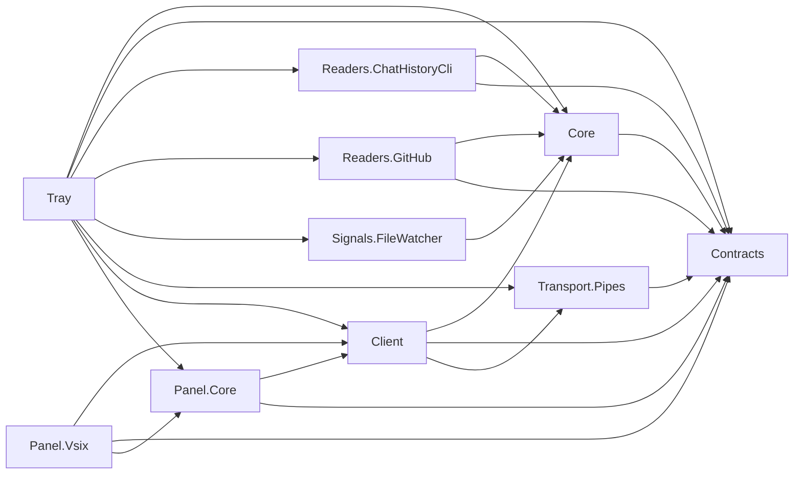

# Code summary

Copilot Usage Meter is a Windows tray tracking host and Exp-only compact Visual Studio chat integration. Phase 4 composes real toolkit CLI/monthly/current-chat reads, DB/WAL signals, separate optional GitHub quota sync and per-connection context projection. GitHub sign-in uses an explicitly launched gh browser flow followed by named Windows Credential Manager import. Internal quota/placement/identity APIs remain fragile and labelled; local analytics are never uploaded or attributed to the account. The old probes were removed; demo engine/settings/tool-window code remains only historical fixture code. Eight shared libraries target netstandard2.0, Tray net10.0-windows, VSIX net48 and tests net10.0.

286 automated Meter tests and 467 toolkit tests pass; whole-phase review findings were fixed and independently rechecked. Phase 4 development verification is complete with limits; Exp runtime acceptance and live sign-in (tray-first and Exp-first, one enterprise seat, real credits shown) are recorded in PHASE_PLAN. GitHub account reader supports blank-login discovery through `IAccountCredentialStore.ListGitHubCliLogins` (credential target names only); `GitHubQuotaParser` accepts `token_based_billing: true` only with finite entitlement and credits_used. Phase 5 is not authorized.

## Project dependencies

Arrows mean project references, not implemented runtime flows. Names omit `CopilotUsageMeter.`.

Architecture.Tests references all eight shared libraries and reads project/solution metadata. It is not referenced by production projects.

## Structural symbols

| Project | Symbol | File relative to repo root | Responsibility |
| --- | --- | --- | --- |
| Tray | `App` | `src\CopilotUsageMeter.Tray\App.xaml.cs` | Single-instance WPF entry; composes host and explicit shutdown |
| Tray | `TrayHost` | `src\CopilotUsageMeter.Tray\TrayHost.cs` | Compose source schedulers, protected per-context pipes, atomic pause transitions, coalesced pushes, icon and owned status window |
| Tray | `DemoSettingsStore` | `src\CopilotUsageMeter.Tray\DemoSettingsStore.cs` | Validated atomic local demo-interval persistence; no credentials |
| Tray | `MainWindow` | `src\CopilotUsageMeter.Tray\MainWindow.xaml.cs` | Separate account/local status, cached countdown and optional secure-account controls; closing does not stop tracking |
| Core | `DemoUsageEngine` | `src\CopilotUsageMeter.Core\DemoUsageEngine.cs` | Deterministic detached snapshots, revisions, demo refresh coalescing/pause/settings |
| Core | `CurrentChatUsageTracker` | `src\CopilotUsageMeter.Core\CurrentChatUsageTracker.cs` | In-memory active-session per-turn snapshot replacement, newest-20 cap and detached snapshots |
| Panel.Core | `UsagePanelViewModel` | `src\CopilotUsageMeter.Panel.Core\UsagePanelViewModel.cs` | UI-independent separate-source display, stale cache and acknowledged actions |
| Panel.Vsix | `UsagePackage`, `ChatUsageIntegration`, `CompactUsageView` | `src\CopilotUsageMeter.Panel.Vsix\` | Exp-only injection/reinjection, explicit preferred/top/status tiers, accessible compact bars and expansion |
| Panel.Vsix | `RepositoryContextReader` | `src\CopilotUsageMeter.Panel.Vsix\RepositoryContextReader.cs` | Read solution Git origin locally; send only normalized public owner/repo, not paths |
| Panel.Core | `CompactUsagePresentation`, `RecordedRepositoryKey` | `src\CopilotUsageMeter.Panel.Core\` | Pure source-separated formatting, newest-20 bar scaling/tooltips and supported origin-key parsing |
| Panel.Core | `ActiveChatIdentity` | `src\CopilotUsageMeter.Panel.Core\ActiveChatIdentity.cs` | Bounded approved identity-member/Session/Router bridge reads; validate opaque GUID without reading content or persisting values |
| Core | `TrackingUsageState`, `LocalRecordedRepositoryMap` | `src\CopilotUsageMeter.Core\` | Detached global monthly/account values and ephemeral per-connection chart/repository projection |
| Core | `LocalRefreshScheduler`, `AccountRefreshCoordinator` | `src\CopilotUsageMeter.Core\` | Independent debounced local and active/idle/backoff account single-flight scheduling |
| Readers.ChatHistoryCli | `ChatHistoryReader`, `ChatHistoryProcessRunner` | `src\CopilotUsageMeter.Readers.ChatHistoryCli\` | Bounded, cancellable toolkit-only reads; strict numeric parsing, explicit unknown/failure states |
| Readers.GitHub | `GitHubAccountReader`, `GitHubApiClient`, `WindowsAccountCredentialStore`, `GitHubQuotaParser` | `src\CopilotUsageMeter.Readers.GitHub\` | Approved fixed endpoints, bounded requests, secure app credentials, account isolation and conservative quota mapping |
| Signals.FileWatcher | `LocalStoreChangeSignal` | `src\CopilotUsageMeter.Signals.FileWatcher\LocalStoreChangeSignal.cs` | DB/WAL events plus metadata reconciliation; absent/recreated store recovery |
| Architecture.Tests | `DependencyRulesTests` | `tests/CopilotUsageMeter.Architecture.Tests/DependencyRulesTests.cs` | SLNX membership and source/compiled dependency guards, with negative controls |
| Contracts | `UsageSnapshot`, `ProtocolMessage`, `UsageProtocol` | `src/CopilotUsageMeter.Contracts/` | Separate account/local payloads, validated chart deserialization and request-only context envelopes; see PROTOCOL.md |
| Transport.Pipes | `PipeConnection`, `UsagePipeServer` | `src/CopilotUsageMeter.Transport.Pipes/` | Bounded framing, handshake, subscription, delivery sequencing and broadcast |
| Client | `IUsageClient`, `PipeUsageClient` | `src/CopilotUsageMeter.Client/` | Reconnect/backoff, resynchronization, command acknowledgement and stale cached snapshots |

The toolkit is CLI-only, not a solution reference. Its Phase 4 `usage-turns` source is uncommitted in the external checkout and submodule working tree; the recorded pin remains 12bbfeb pending explicit commit approval. A self-contained portable publish is copied beside the tray. Real-engine resource measurements, shipping installation and broad theme/DPI/accessibility validation remain Phase 5.

See `docs/KEY_FLOWS.md` for traced end-to-end call flows.

## Graph coverage

Registry and query command are in `.github/copilot-instructions.md`. Registered graph incrementally refreshed on 2026-11-10 from the Phase 4 working tree: 1,173 nodes, 4,186 edges across 11 projects, in 21.02 seconds. The paired dependencies output was immediately renamed to its registered slug. HEAD remains `3532972`; the working changes are not committed. Contracts/Core/Transport.Pipes metadata-reference warnings and the linked DemoSettingsStore duplicate-key query limitation persist, so structural queries may be incomplete and missing results are not proof of absent source. Viewer loads slug-named files using file picker/drag-and-drop, not its legacy automatic filenames.
