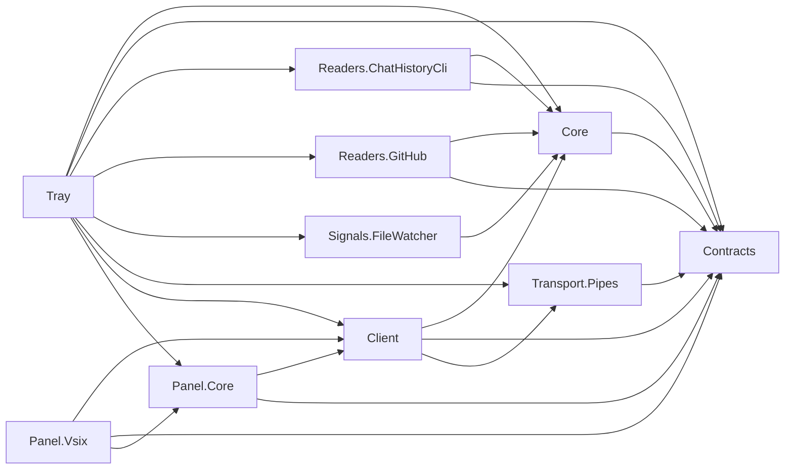

# Code summary

Copilot Usage Meter is a Windows tray host and planned Visual Studio usage expander. Phase 2 implements an invented-data engine, same-user pipes, real tray lifetime/status/settings and an explicit temporary experimental VSIX test window. Account/local sources remain separate; no real authentication, GitHub/history reads or chat embedding. Eight shared libraries target netstandard2.0, Tray net10.0-windows, VSIX net48 and tests net10.0.

`PHASE_PLAN.md` is authoritative. Phase 2 is complete; Phase 3 needs user direction. Stable SDK 10.0.403 is pinned with prerelease disabled. Full build, all 57 tests and live experimental-instance checks passed; independent phase-review findings were fixed and verified. Open `CopilotUsageMeter.slnx`, the sole solution.

## Project dependencies

Arrows mean project references, not implemented runtime flows. Names omit `CopilotUsageMeter.`.

Architecture.Tests references all eight shared libraries and reads project/solution metadata. It is not referenced by production projects.

## Structural symbols

| Project | Symbol | File relative to repo root | Responsibility |
| --- | --- | --- | --- |
| Tray | `App` | `src\CopilotUsageMeter.Tray\App.xaml.cs` | Single-instance WPF entry; composes host and explicit shutdown |
| Tray | `TrayHost` | `src\CopilotUsageMeter.Tray\TrayHost.cs` | Engine, protected pipe endpoint, command/timer serialization, icon/menu and owned-window lifetime |
| Tray | `DemoSettingsStore` | `src\CopilotUsageMeter.Tray\DemoSettingsStore.cs` | Validated atomic local demo-interval persistence; no credentials |
| Tray | `MainWindow` | `src\CopilotUsageMeter.Tray\MainWindow.xaml.cs` | Demo status/settings UI; closing does not stop tracking |
| Core | `DemoUsageEngine` | `src\CopilotUsageMeter.Core\DemoUsageEngine.cs` | Deterministic detached snapshots, revisions, demo refresh coalescing/pause/settings |
| Panel.Core | `UsagePanelViewModel` | `src\CopilotUsageMeter.Panel.Core\UsagePanelViewModel.cs` | UI-independent separate-source display, stale cache and acknowledged actions |
| Panel.Vsix | `UsagePackage`, `UsageDemoToolWindow` | `src\CopilotUsageMeter.Panel.Vsix\` | Tools command and explicitly temporary pipe-test window; no chat injection |
| Architecture.Tests | `DependencyRulesTests` | `tests/CopilotUsageMeter.Architecture.Tests/DependencyRulesTests.cs` | SLNX membership and source/compiled dependency guards, with negative controls |
| Contracts | `UsageSnapshot`, `ProtocolMessage`, `UsageProtocol` | `src/CopilotUsageMeter.Contracts/` | Separate demo account/local payloads and v1 envelopes; see PROTOCOL.md |
| Transport.Pipes | `PipeConnection`, `UsagePipeServer` | `src/CopilotUsageMeter.Transport.Pipes/` | Bounded framing, handshake, subscription, delivery sequencing and broadcast |
| Client | `IUsageClient`, `PipeUsageClient` | `src/CopilotUsageMeter.Client/` | Reconnect/backoff, resynchronization, command acknowledgement and stale cached snapshots |

Readers.ChatHistoryCli, Readers.GitHub and Signals.FileWatcher remain empty. Proposed production accounting/authentication types in ARCHITECTURE.md are not existing code. Experimental runtime checks include two VS instances and elevated clients with an unelevated tray; no production feasibility or resource claims.

See `docs/KEY_FLOWS.md` for traced end-to-end call flows.

## Graph coverage

Registry and query command are in `.github/copilot-instructions.md`. Incremental graph refreshed from the Phase 2 working tree on 2026-11-10: 274 nodes, 1,029 edges across 11 projects, in 25.47 seconds. The paired dependencies output was immediately renamed to its registered slug; a query now finds the new panel symbols. Contracts/Core/Transport.Pipes metadata-reference warnings persist, so structural queries may be incomplete and missing results are not proof of absent source. Viewer loads slug-named files using file picker/drag-and-drop, not its legacy automatic filenames.
