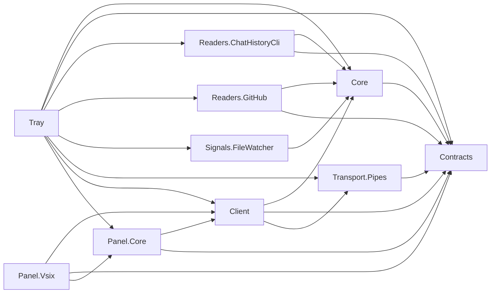

# Code summary

Copilot Usage Meter is a Windows tray host and planned Visual Studio usage expander. GitHub account usage and this-machine analytics remain separate; local chat history is never uploaded. Hosts remain scaffolds: eight empty netstandard2.0 libraries, a net10.0-windows WPF launch window, a net48 VSIX package and net10.0 architecture tests.

`PHASE_PLAN.md` is the authoritative progress/acceptance record. The approved Phase 2 baseline uses stable SDK 10.0.403 with prerelease disabled; full solution/VSIX build and 23 architecture tests passed after retargeting. Phase 2 behavior is not implemented. Open `CopilotUsageMeter.slnx`, the sole solution.

## Project dependencies

Arrows mean project references, not implemented runtime flows. Names omit `CopilotUsageMeter.`.

Architecture.Tests references all eight shared libraries and reads project/solution metadata. It is not referenced by production projects.

## Structural symbols

| Project | Symbol | File relative to repo root | Responsibility |
| --- | --- | --- | --- |
| Tray | `App` | `src/CopilotUsageMeter.Tray/App.xaml.cs` | WPF application entry; StartupUri opens the scaffold window |
| Tray | `MainWindow` | `src/CopilotUsageMeter.Tray/MainWindow.xaml.cs` | Initializes the explicitly labeled scaffold UI; not a tray icon/engine |
| Panel.Vsix | `UsagePackage` | `src/CopilotUsageMeter.Panel.Vsix/UsagePackage.cs` | Empty AsyncPackage registration; no panel/injection yet |
| Architecture.Tests | `DependencyRulesTests` | `tests/CopilotUsageMeter.Architecture.Tests/DependencyRulesTests.cs` | SLNX membership and source/compiled dependency guards, with negative controls |

Contracts, Core, Readers.ChatHistoryCli, Readers.GitHub, Signals.FileWatcher, Transport.Pipes, Client and Panel.Core have no implemented types yet. Proposed interfaces/DTOs in ARCHITECTURE.md are not existing code.

See `docs/KEY_FLOWS.md` for traced end-to-end call flows.

## Graph coverage

Registry and query command are in `.github/copilot-instructions.md`. Full graph rebuilt from commit `0aa1080`: 23 nodes, 93 edges across 11 projects, in 14.02 seconds. Builder warned about project references without matching metadata references for Contracts, Core and Transport.Pipes; structural queries may be incomplete. A missing graph result is not proof of absent source. Viewer loads slug-named files using file picker/drag-and-drop, not its legacy automatic filenames.