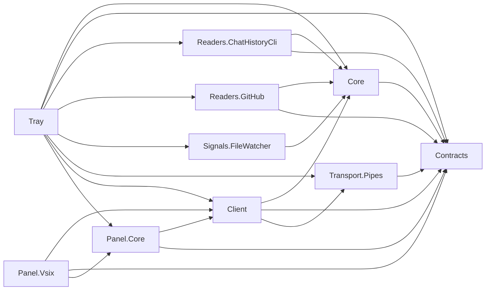

# Code summary

Copilot Usage Meter is a Windows tray tracking host and Exp-only compact Visual Studio chat integration. Phase 4 composes real toolkit CLI/monthly/current-chat reads, DB/WAL signals, separate optional GitHub quota sync and per-connection context projection. GitHub sign-in uses an explicitly launched gh browser flow followed by named Windows Credential Manager import. Internal quota/placement/identity APIs remain fragile and labelled; local analytics are never uploaded or attributed to the account. The old probes were removed; demo engine/settings/tool-window code remains only historical fixture code. Eight shared libraries target netstandard2.0, Tray net10.0-windows, VSIX net48 and tests net10.0.

317 automated Meter tests

## Project dependencies

Arrows mean project references, not implemented runtime flows. Names omit `CopilotUsageMeter.`.

Architecture.Tests references all eight shared libraries and reads project/solution metadata. It is not referenced by production projects.

## Structural symbols

| Project | Symbol | File relative to repo root | Responsibility |
| --- | --- | --- | --- |
| Tray | `App` | `src\CopilotUsageMeter.Tray\App.xaml.cs` | Single-instance WPF entry; composes host and explicit shutdown |
| Tray | `TrayHost` | `src\CopilotUsageMeter.Tray\TrayHost.cs` | Compose source schedulers, protected per-context pipes, atomic pause transitions, coalesced pushes, icon and owned status window |
| Tray | `TrayIconPainter` | `src\CopilotUsageMeter.Tray\TrayIconPainter.cs` | Draws the usage ring (thin track, thick arc) for the tray icon |
| Tray | `StartWithWindows` | `src\CopilotUsageMeter.Tray\StartWithWindows.cs` | HKCU Run-value toggle for the "Start with Windows" menu item (linked into the tests; key path injectable) |
| Tray | `WindowPlacement` | `src\CopilotUsageMeter.Tray\WindowPlacement.cs` | UI-free window position/size with `Fit` into a work area; the Full details window remembers it in memory between close and reopen |
| Tray / Panel.Vsix | `UsageTheme` | `src\CopilotUsageMeter.Tray\UsageTheme.cs` (linked into VSIX) | Host-only WPF high-contrast brushes, opacity policy and contrasting badge text; no WPF types in shared libraries |
| Panel.Core | `ColorContrast` | `src\CopilotUsageMeter.Panel.Core\ColorContrast.cs` | UI-free sRGB luminance and higher-contrast black/white text selection |
| Tray | `NotificationIdentity` | `src\CopilotUsageMeter.Tray\NotificationIdentity.cs` | Sets the process AppUserModelID and its HKCU display name/icon so notifications show the app name and ring icon |
| Tray | `GitHubAccountRemoval` | `src\CopilotUsageMeter.Tray\GitHubAccountRemoval.cs` | UI-free removal of a saved gh login (one at a time); signs the tray out when the removed login is the connected one |
| Tray | `GitHubSignInFlow`, `GitHubSignInWindow` | `src\CopilotUsageMeter.Tray\GitHubSignInFlow.cs`, `GitHubSignInWindow.xaml(.cs)` | UI-free sign-in state machine (linked into the tests) and the WPF dialog that shows the one-time code, with fallback to a visible console |
| Tray | `DemoSettingsStore` | `src\CopilotUsageMeter.Tray\DemoSettingsStore.cs` | Validated atomic local demo-interval persistence; no credentials |
| Tray | `MainWindow` | `src\CopilotUsageMeter.Tray\MainWindow.xaml.cs` | Full details window drawn from `UsageDisplay`: GitHub/local sections, turn chart, labelled detail rows, Log out confirm, fault banner, secure-account controls; closing does not stop tracking |
| Core | `DemoUsageEngine` | `src\CopilotUsageMeter.Core\DemoUsageEngine.cs` | Deterministic detached snapshots, revisions, demo refresh coalescing/pause/settings |
| Core | `CurrentChatUsageTracker` | `src\CopilotUsageMeter.Core\CurrentChatUsageTracker.cs` | In-memory active-session per-turn snapshot replacement, newest-20 cap and detached snapshots |
| Panel.Core | `UsagePanelViewModel` | `src\CopilotUsageMeter.Panel.Core\UsagePanelViewModel.cs` | UI-independent separate-source display, stale cache and acknowledged actions |
Exp-only injection/reinjection, explicit preferred/top/status tiers; `CompactUsageView` is an adaptive one-line row (wide/medium/narrow) with an anchored popup, icon toolbar and inline Log out confirm
| Panel.Vsix | `RepositoryContextReader` | `src\CopilotUsageMeter.Panel.Vsix\RepositoryContextReader.cs` | Read solution Git origin locally; send only normalized public owner/repo, not paths |
| Panel.Core | `UsageDisplay` | `src\CopilotUsageMeter.Panel.Core\UsageDisplay.cs` | Shared presentation model for the row, popup and Full details window: levels (85% warning, over, stale after 30 minutes), segment arithmetic, bar tooltips, labelled detail rows; no UI types |
| Panel.Core | `ProductVersion` | `src\CopilotUsageMeter.Panel.Core\ProductVersion.cs` | Formats an assembly version for display (strips build metadata and a trailing .0); the shared `Directory.Build.props` version feeds the tray title and the popup label |
| Panel.Core | `CompactUsagePresentation`, `RecordedRepositoryKey`
| Panel.Core | `ActiveChatIdentity` | `src\CopilotUsageMeter.Panel.Core\ActiveChatIdentity.cs` | Bounded approved identity-member/Session/Router bridge reads; validate opaque GUID without reading content or persisting values |
| Core | `TrackingUsageState`, `LocalRecordedRepositoryMap` | `src\CopilotUsageMeter.Core\` | Detached global monthly/account values and ephemeral per-connection chart/repository projection |
| Core | `LocalRefreshScheduler`, `AccountRefreshCoordinator` | `src\CopilotUsageMeter.Core\` | Independent debounced local and active/idle/backoff account single-flight scheduling |
| Core | `RefreshActivity` | `src\CopilotUsageMeter.Core\RefreshActivity.cs` | Per-source refresh activity with a minimum-visible delay, feeding `UsageSnapshot.IsRefreshing` |
| Core | `AlertSettings`, `AlertLevel`, `AlertChannel` | `src\CopilotUsageMeter.Core\AlertSettings.cs` | Opt-in alert settings: levels 1-200%, max 10, normalised; per-level channel |
| Core | `ThresholdAlertTracker`, `ThresholdAlertText` | `src\CopilotUsageMeter.Core\ThresholdAlertTracker.cs` | Threshold crossing rules (once per UTC month and crossing, fresh "available" account data only) and fixed alert wording |
| Tray | `ThresholdAlertService`, `AlertSettingsStore`, `AlertStateStore` | `src\CopilotUsageMeter.Tray\ThresholdAlertService.cs`, `AlertStores.cs` | UI-free glue: loads/saves `alerts.json` and `alert-state.json`, evaluates each account update, presents through a callback (linked into the tests) |
| Tray | `AlertSettingsWindow`, `AlertWindow` | `src\CopilotUsageMeter.Tray\AlertSettingsWindow.xaml(.cs)`, `AlertWindow.xaml(.cs)` | Settings editor with test buttons and the problem-notification check box (added in code); non-modal topmost message window that does not take focus |
| Core | `HealthAlertTracker`, `HealthSignals`, `HealthAlertText` | `src\CopilotUsageMeter.Core\HealthAlertTracker.cs` | Problem-notification rules (observation count, duration, once until recovery, 6 h cool-down), mapping of read results to conditions, fixed wording |
| Tray | `HealthAlertService` | `src\CopilotUsageMeter.Tray\HealthAlertService.cs` | UI-free glue: feeds account/local/fault observations to the tracker and presents through a callback (linked into the tests) |
| Panel.Core | `ExtensionNoticeTracker`, `ExtensionSignals`, `ExtensionNoticeText` | `src\CopilotUsageMeter.Panel.Core\ExtensionNoticeTracker.cs` | Pure rules for extension infobars (tray unreachable, version mismatch, unrecognised chat layout): delay, once per problem, cool-down, retry, close on recovery; maps pipe status text to connection state; fixed wording |
| Panel.Vsix | `InfoBarPresenter` | `src\CopilotUsageMeter.Panel.Vsix\InfoBarPresenter.cs` | Shows and closes the fixed-wording notices as Visual Studio main-window infobars; reports user dismissal |
| Panel.Vsix | `CompactUsageView`, nested `EscapeCommandTarget` | `src\CopilotUsageMeter.Panel.Vsix\CompactUsageView.cs` | Anchored popup registers a VS priority target only while open for standard Escape/CANCEL; close/unload unregisters it, dismissal returns focus to the chevron and failures use the integration's existing diagnostics |
| Readers.ChatHistoryCli | `ChatHistoryReader`, `ChatHistoryProcessRunner` | `src\CopilotUsageMeter.Readers.ChatHistoryCli\` | Bounded, cancellable toolkit-only reads; strict numeric parsing, explicit unknown/failure states |
| Readers.GitHub | `GitHubAccountReader`, `GitHubApiClient`, `WindowsAccountCredentialStore`, `GitHubQuotaParser`, `GitHubCliSignIn`, `GitHubCliProcessLauncher`, `GitHubCliLogout` | `src\CopilotUsageMeter.Readers.GitHub\` | Approved fixed endpoints, bounded requests, secure app credentials, account isolation and conservative quota mapping |
| Signals.FileWatcher | `LocalStoreChangeSignal` | `src\CopilotUsageMeter.Signals.FileWatcher\LocalStoreChangeSignal.cs` | DB/WAL events plus metadata reconciliation; absent/recreated store recovery |
| Architecture.Tests | `DependencyRulesTests` | `tests/CopilotUsageMeter.Architecture.Tests/DependencyRulesTests.cs` | SLNX membership and source/compiled dependency guards, with negative controls |
| Contracts | `UsageSnapshot`, `ProtocolMessage`, `UsageProtocol`, `Diagnostics`, `IDiagnosticsSink` | `src/CopilotUsageMeter.Contracts/` | Separate account/local payloads, validated chart deserialization and request-only context envelopes; see PROTOCOL.md. `Diagnostics` is the privacy-safe (type + HRESULT only) failure log; sinks: tray `FileDiagnosticsSink` (`logs\tray.log`), VSIX `ActivityLogDiagnosticsSink` |
| Transport.Pipes | `PipeConnection`, `UsagePipeServer` | `src/CopilotUsageMeter.Transport.Pipes/` | Bounded framing, handshake, subscription, delivery sequencing and broadcast |
| Client | `IUsageClient`, `PipeUsageClient` | `src/CopilotUsageMeter.Client/` | Reconnect/backoff, resynchronization, command acknowledgement and stale cached snapshots |

The toolkit is CLI-only, not a solution reference. Its Phase 4 `usage-turns` source is uncommitted in the external checkout and submodule working tree; the recorded pin remains 12bbfeb pending explicit commit approval. A self-contained portable publish is copied beside the tray. Real-engine resource measurements, shipping installation and broad theme/DPI/accessibility validation remain Phase 5.

See `docs/KEY_FLOWS.md` for traced end-to-end call flows.

## Graph coverage

Registry and query command are in `.github/copilot-instructions.md`. Registered graph incrementally refreshed on 2026-11-10 from the Phase 4 working tree: 1,173 nodes, 4,186 edges across 11 projects, in 21.02 seconds. The paired dependencies output was immediately renamed to its registered slug. HEAD remains `3532972`; the working changes are not committed. Contracts/Core/Transport.Pipes metadata-reference warnings and the linked DemoSettingsStore duplicate-key query limitation persist, so structural queries may be incomplete and missing results are not proof of absent source. Viewer loads slug-named files using file picker/drag-and-drop, not its legacy automatic filenames.
